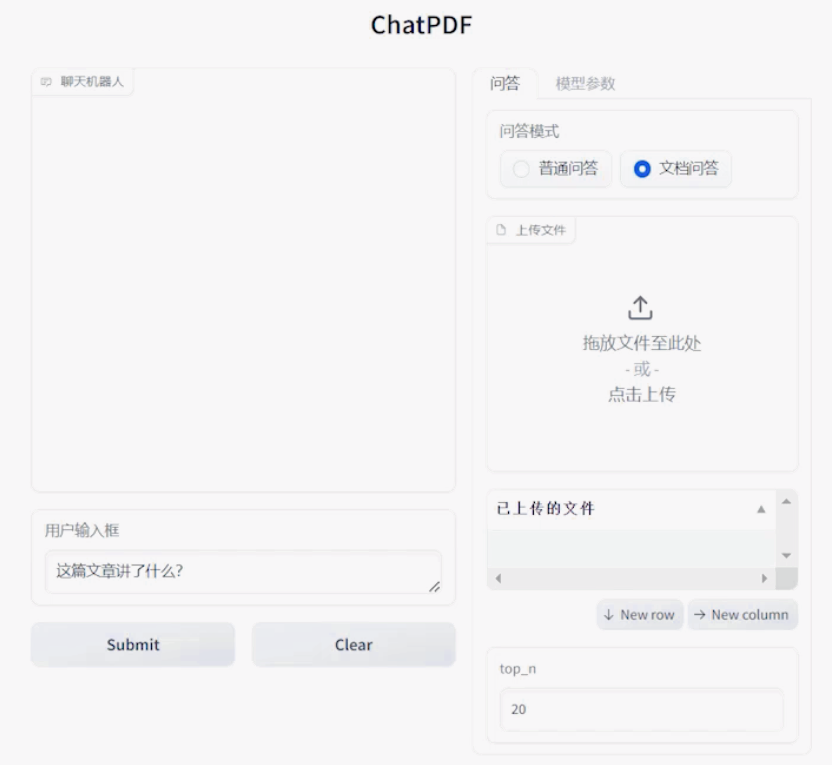
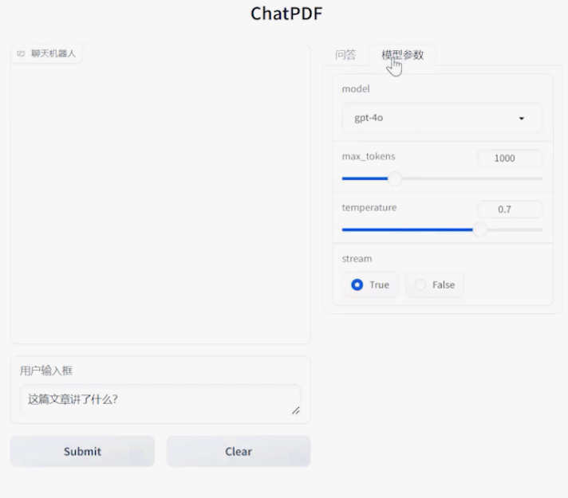

# ChatPDF

ChatPDF is a document-based intelligent Q&A application built with **Gradio, LLM, and RAG**. Users can upload PDF/TXT documents and interact with them using natural language.

## Main Features

* **General Q&A**: Have multi-turn conversations with the large language model.
* **Document Q&A**: Retrieve relevant content from uploaded documents using RAG and generate answers.
* **Multiple File Upload**: Support uploading multiple PDF/TXT files.
* **Model Parameter Configuration**: Configure the model and adjust parameters such as `max_tokens` and `temperature`.
* **Retrieval Configuration**: Use `top_n` to control the number of retrieved document chunks.
* **Streaming Output**: Display the model's generated response in real time.

## Interface





## Running the Project

### 1. Create a Virtual Environment and Install Dependencies

```bash
conda create -n py38_LLMAppCourse2_ChatPDF python=3.8
conda activate py38_LLMAppCourse2_ChatPDF
pip install -r requirements.txt
```

### 2. Configure Environment Variables

Copy the `.env.example` file and rename it to `.env`. Then configure the environment variables according to the API service you are using.

#### Using the Official OpenAI API

Configure the following variables:

```text
OPENAI_API_KEY=sk-xxx
HTTP_PROXY=http://127.0.0.1:33210
HTTPS_PROXY=http://127.0.0.1:33210
```

If a proxy is required in your network environment, start the proxy software and configure its port in `HTTP_PROXY` and `HTTPS_PROXY`.

#### Using a Domestic API Service

If you are using a domestic API provider that is compatible with the OpenAI API format, configure:

```text
OPENAI_API_KEY=sk-xxx
OPENAI_BASE_URL=https://api.example.com/v1
```

Set `OPENAI_BASE_URL` to the API base URL provided by the corresponding service provider.

### 3. Test the API

Run `MyGPT.py` to verify that the API connection is working:

```bash
python MyGPT.py
```

If the API call is successful, you should see output similar to:

```text
你好！有什么我可以帮忙的吗？
总token数: 17
```

### 4. Start Qdrant

Start the `Qdrant` vector database container using Docker.

### 5. Start ChatPDF

Run:

```bash
python app.py
```

After the application starts successfully, the terminal will display:

```text
Running on local URL: http://127.0.0.1:7860
```

Open the URL in your browser to use ChatPDF.
