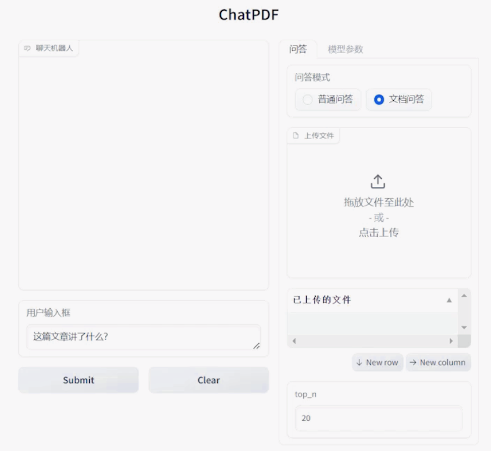
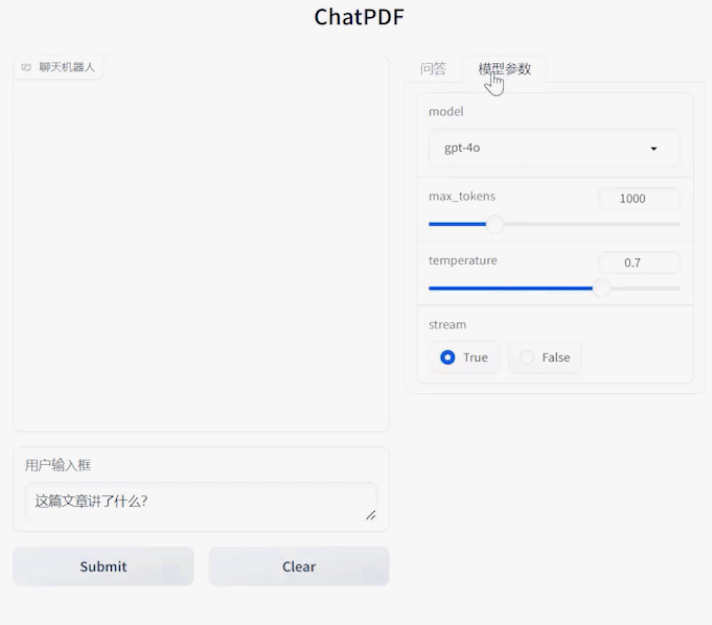

# ChatPDF

ChatPDF 是一个基于 **Gradio + LLM + RAG** 构建的文档智能问答应用。用户可以上传 PDF/TXT 文档，并通过自然语言与文档进行交互。

## 主要功能

* 普通问答：与大语言模型进行多轮对话。
* 文档问答：基于上传文档进行 RAG 检索并生成回答。
* 多文件上传：目前支持同时上传多个 PDF/TXT 文件，可扩展。
* 模型参数设置：支持调整模型、`max_tokens`、`temperature` 等参数。
* 检索参数设置：通过 `top_n` 控制检索文档片段数量。
* 流式输出：支持实时显示模型生成内容。

## 界面





## 运行

### 1. 创建虚拟环境并安装依赖

```bash
conda create -n py38_LLMAppCourse2_ChatPDF python=3.8
conda activate py38_LLMAppCourse2_ChatPDF
pip install -r requirements.txt
```

### 2. 配置环境变量

复制 `.env.example` 文件，并重命名为 `.env`，然后根据使用的 API 服务配置环境变量。

#### 使用 OpenAI 官方 API

需要配置：

```text
OPENAI_API_KEY=sk-xxx
HTTP_PROXY=http://127.0.0.1:33210
HTTPS_PROXY=http://127.0.0.1:33210
```

如果网络环境需要代理，请先启动代理软件，并将端口配置到 `HTTP_PROXY` 和 `HTTPS_PROXY`。

#### 使用国内 API 服务

如果使用兼容 OpenAI API 格式的国内服务商，可以配置：

```text
OPENAI_API_KEY=sk-xxx
OPENAI_BASE_URL=https://api.example.com/v1
```

其中 `OPENAI_BASE_URL` 使用对应 API 服务商提供的地址。

### 3. 测试 API

运行 `MyGPT.py` 测试 API 是否能够正常连接：

```bash
python MyGPT.py
```

如果 API 调用成功，会看到类似输出：

```text
你好！有什么我可以帮忙的吗？
总token数: 17
```

### 4. 启动 Qdrant

使用 Docker 启动 `Qdrant` 向量数据库容器。

### 5. 启动 ChatPDF

运行：

```bash
python app.py
```

启动成功后会显示：

```text
Running on local URL: http://127.0.0.1:7860
```

在浏览器中打开该地址即可使用 ChatPDF。

